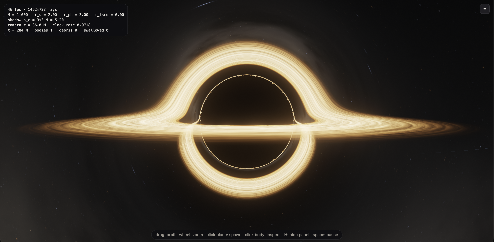
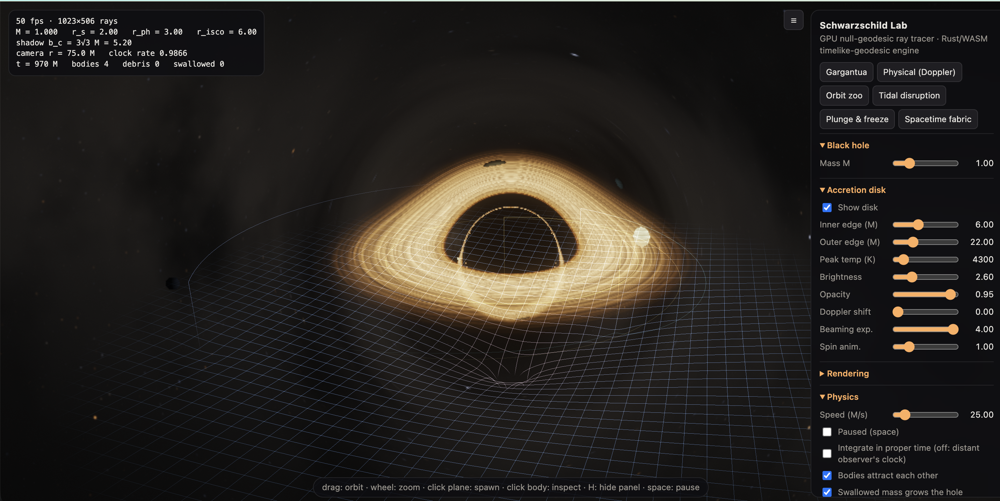

# Schwarzschild Lab

**[Try it live →](https://zahintapadar.github.io/schwarzschild-lab/)** (needs a WebGL2 browser) · **[Read the devlog →](https://zahin-tapadar.vercel.app/blog/building-a-black-hole-simulator/)**

A real-time black hole you can play with in the browser. A GPU ray tracer bends every pixel's light ray around a Schwarzschild black hole, while a Rust physics engine compiled to WebAssembly moves planets, stars and gas clouds along exact relativistic orbits.





## What's inside

**Ray tracer (WebGL2 / GLSL)**
- Null geodesics integrated per pixel with adaptive RK4: coarse far away, fine near the photon sphere
- Thin Keplerian accretion disk with a Novikov-Thorne temperature profile
- Relativistic Doppler shift, beaming and gravitational redshift from each photon's conserved angular momentum
- Blackbody colours from a Planck spectrum integrated against the CIE 1931 colour-matching functions
- HDR pipeline with a bloom chain
- A calibrated synthetic sky (stars, dust, clusters, nebulae, galaxies) lensed by the same geodesics (see [Synthetic sky](#synthetic-sky))

**Physics engine (Rust → WebAssembly)**
- Massive bodies follow the exact Schwarzschild timelike geodesic equation, so orbits precess, the ISCO sits at 6M and the photon sphere at 3M
- Run in a distant observer's time (bodies redden and freeze at the horizon) or in each body's proper time
- Optional body-to-body attraction, tidally shredded gas clouds and a hole that grows as it swallows mass

**Presets:** Gargantua, Physical (Doppler), Orbit zoo, Tidal disruption, Plunge & freeze, Spacetime fabric, Lensed synthetic sky

## Synthetic sky

The background is a **calibrated synthetic sky model**: one stochastic realisation of a physically motivated Milky Way and galaxy field, generated on the GPU in the spirit of population-synthesis models such as the Gaia Universe Model and the Besançon model. It is **not** a map of the real sky, uses no survey catalogue, and is not an N-body or cosmological simulation.

It is evaluated once per pixel, in the direction a ray is travelling *after* it escapes the hole's gravity. Nothing is warped in screen space, so the Einstein arcs, counter-images and squeezing against the photon ring all come from the null geodesics themselves. Rays that fall in stay black.

### Model

| Component | Formula and parameters (kpc, V mag) |
| --- | --- |
| Thin disc | ρ ∝ e^−(R−R₀)/2.6 · e^−\|z\|/0.30, with a central hole 1 − e^−(R/3)² |
| Thick disc | 0.12 · e^−(R−R₀)/2.0 · e^−\|z\|/0.9 |
| Bar / bulge | 120 · exp(−½[(x/1.2)² + (y/0.45)² + (z/0.35)²]), rotated 27° |
| Stellar halo | 0.0015 · ((R² + (z/0.7)² + 0.5²) / (R₀² + 0.5²))^−1.25 |
| Normalisation | N₀ = 4.2 × 10⁷ stars kpc⁻³ in the solar neighbourhood (R₀ = 8.2, z☉ = 0.02) |
| Mass function | Kroupa: m^−1.3 (0.08–0.5 M☉), m^−2.3 (0.5–1), then m^−4.8 to 60 M☉ for the thin disc (constant star formation) or a 0.95 M☉ turn-off for old populations; M_V = 4.83 − 8.75 log m; 0.3–0.6% giants at M_V ∈ [−1.5, 1.5] |
| Dust | τ_V = 0.74 kpc⁻¹ · e^−(R−R₀)/3.2 · e^−\|z\|/0.12 · C, where C is a lognormal cloud field whose contrast is high in the plane and small at high latitude |
| Galaxies | N(<m) = 1500 sr⁻¹ · 10^0.6(m−15), modulated by a lognormal far-field density and hidden behind 10^−0.6·A_B of Galactic extinction |

With these values the model's all-sky star counts land within about 30% of the observed counts from V < 0 to V < 15 (e.g. 4.6 vs ~4 stars brighter than V = 0, and 4,640 vs ~5,000 brighter than V = 6). The calibration was done with a JavaScript port of the same equations.

### Sampling

- Every line of sight is cut into 10 logarithmic distance shells (5 pc to 40 kpc). Each shell gets its stellar weights, its distance modulus and its extinction to the shell centre.
- Stars come in magnitude bins, each drawn on its own level of an equal-angle cube-sphere grid. The expected count per cell λ comes from the line-of-sight integral of ρ·r²·dr·dΩ, convolved with the luminosity function. The count is a Poisson draw (up to 3 per cell; any excess is kept as mean flux), and each star's shell, population, mass or giant class, temperature and reddening are then drawn from that cell's own distribution.
- Every random value is a PCG hash of (seed, level, face, cell, index), so the same seed rebuilds the same sky exactly. A different seed gives another draw from the same model. The galactic frame, the density model and the analytic functions are fixed.
- Stars fainter than the magnitude limit, and any star smaller than the pixel footprint, are added as integrated light from the same model. Resolution changes therefore alter sharpness but not total brightness.

### Radiance

I = I_stars + I_unresolved·e^−τ + I_DGL + I_emission + I_scattered + I_galaxies

- **Stars:** flux 10^−0.4(m−4.5), blackbody colour at the drawn temperature, reddened by E(B−V) = A_V/3.1. Each is drawn as a round ~1.6 px spot through the screen-to-sky Jacobian, so stars stay sharp where lensing stretches the image and get brighter with lensing magnification.
- **Diffuse galactic light:** single scattering of the model's mean starlight (2,250 flux units per sr) by the dust column, I ∝ 0.3·J·(1 − e^−τ). This is what makes dust lanes look dark against a faint glow instead of like a flat grey fog.
- **Clusters and nebulae:** open clusters are drawn from the young-disc density (scale height 60 pc) and boosted where clouds are dense. A cluster's age, richness and distance set its most massive member through the main-sequence turn-off. Its brightest stars are drawn individually and the rest become Plummer-profile glow.
  - **HII region:** only if the cluster has a star above 15 M☉, is younger than 8 Myr and sits in a dense cloud (C > 1.3). Size follows a Strömgren-like scaling, and the surface brightness is 16.5–19.5 mag/arcsec².
  - **Reflection nebula:** needs a B star, a cloud (C > 1.1) and no ionising source. It is blue-weighted with inverse-square illumination.
  - Nebulae are rare and localised. Their irregular shapes come from noise, which is a visual approximation.
- **Galaxies:** Sérsic n = 4 ellipticals; exponential discs with isotropic inclinations and an intrinsic thickness of 0.15; spirals with 2–4 logarithmic arms, star-forming knots and a dust lane that strengthens edge-on. Sizes follow R ∝ L^0.5. At the calibrated counts galaxies are as faint as on the real sky, small smudges that show up only when you zoom in. Redshift reddening and (1+z)⁻⁴ dimming are visual approximations.
- **Observer motion:** the Doppler factor D is applied once, to stars (T × D) and to total sky intensity (× D³).

### Controls

The **Synthetic sky** panel has the universe seed (with **New universe**), overall sky intensity, star magnitude limit, star density, star brightness, Milky Way glow, dust extinction, nebulae and galaxy density. Setting any one to 0 removes only its own layer. **Debug view** switches the sky to population density, extinction A_V, expected star counts, nebula conditions or the galaxy density field.

The **Lensed synthetic sky** preset sets seed 1977 and aims just south of the model's Galactic centre, so the bulge starlight and dust lane behind the hole are bent into Einstein arcs. URL parameters reproduce any view (camera yaw and pitch in radians, distance in M):

```
?preset=Lensed%20synthetic%20sky
?spaceSeed=1977&showDisk=0&camMotion=static&yaw=2.9644&pitch=-0.4188&dist=60
?spaceSeed=42&showDisk=0&camMotion=static&yaw=2.9644&pitch=-0.4188&dist=60
```

### Limitations

- A small, fixed set of distance shells and Poisson candidates per cell. Spiral arms and young-disc structure are not modelled in 3D.
- Stellar evolution is a main-sequence mass–luminosity law plus a giant fraction, with no isochrones or metallicity tracks.
- Large-scale structure is a lognormal field on the sphere, not the result of gravitational evolution.
- There are no Local Group objects (no Andromeda or Magellanic Clouds), so prominent galaxies are rare.

## Schwarzschild Observatory

**[Open the Observatory →](https://zahintapadar.github.io/schwarzschild-lab/observatory/)** · [technical write-up](observatory/README.md)

A separate, slow sibling of the real-time simulator: a progressive synthetic telescope. Its scenes have physical scale. The hole has a mass in solar masses and a distance in parsecs, so the shadow, the disk and the Einstein radius have definite angular sizes on the detector, and the disk's brightness follows from its accretion rate. A separate local-observer mode is used only for geodesic and critical-curve validation. Instead of one ray per pixel per frame, it accumulates thousands of samples per pixel. Each sample goes through an adaptive Dormand–Prince geodesic integrator and carries the light as a 26-channel spectrum (20 continuum bins and 6 emission lines). The renderer lenses a generated 3D nebula placed at a finite distance behind the hole, then simulates the camera that records it: filters, quantum efficiency, ND filter, PSF, Poisson shot noise, read noise and saturation. Diagnostics (ray fate, parity, winding, redshift, optical depth) are kept apart from presentation images and carry legends and fixed scales. It exports PNG, linear OpenEXR and standard FITS with full metadata. It lives in [`observatory/`](observatory/) and does not touch the real-time code.

## Run it

```sh
./build.sh
```

This builds the engine to `web/engine.wasm` and serves the app at <http://localhost:8765>. It needs Rust with the `wasm32-unknown-unknown` target:

```sh
rustup target add wasm32-unknown-unknown
```

A prebuilt `web/engine.wasm` is committed, so to try it without Rust you can serve the `web/` folder with any static server.

## Controls

| Input | Action |
| --- | --- |
| Drag | Orbit the camera |
| Wheel | Zoom |
| Click the plane | Spawn a planet, star, gas cloud or swarm |
| Click a body | Inspect it |
| `H` | Hide the panel |
| `Space` | Pause |

Units are geometric (G = c = 1) with every length measured in black-hole masses M; the event horizon is at r = 2M.
