# Schwarzschild Observatory

**A progressive synthetic telescope around a black hole.** [Open it in the browser →](https://zahintapadar.github.io/schwarzschild-lab/observatory/)


*First Light — Observatory HDR Composite (1024 × 640). It is a synthetic HDR composite of registered virtual exposures, not a single detector frame. A 4.3 × 10⁶ M☉ hole is seen from 20,000 M with a 10 cm telescope. The disk's radiance follows from its accretion rate, and six frames from 20 µs through ND 6 to 120 s unfiltered are merged in linear units before one display curve.*

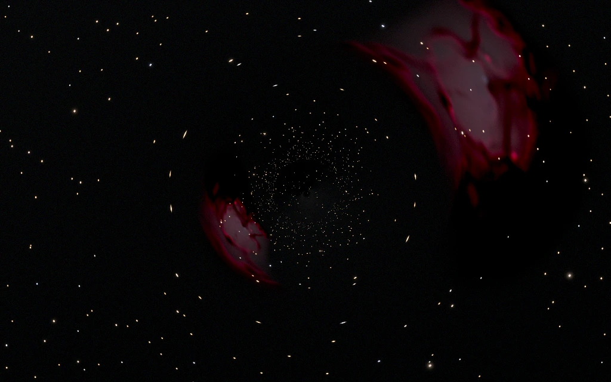

*Lensed H II Region — Offset Source (1024 × 640, one 300 s exposure). A 24 pc nebula 22′ off axis, larger than the 20′ Einstein radius, forms an outer arc and a mirrored counter-image on the far side of the 9″ shadow.*

The [real-time simulator](../README.md) answers "what does it look like *now*?" at 60 frames per second. The Observatory answers a different question: "what would a camera record if it pointed at this, and how much of that can we justify?" It traces thousands of rays per pixel through an accuracy-controlled geodesic integrator and carries the light as a spectrum. It lenses a generated three-dimensional nebula placed at a physical distance, then simulates the sensor that turns photons into electrons. The output is data (linear OpenEXR, standard FITS) plus images labelled by class: presentation, diagnostic, physical single exposure, registered HDR composite, stacked survey, false-colour narrowband.

The two are separate products in one repository. The Observatory lives entirely in `observatory/`; the real-time simulator in `web/` and `engine/` is unchanged.

Everything here is a *synthetic instrument simulation of a statistically synthesized scene*. It is not a real observation.

## Labels

Every model in this document carries one of these labels:

| Label | Meaning |
| --- | --- |
| **Physically derived** | Follows from the stated physics with no free parameters beyond the scene's inputs. |
| **Numerically approximated** | A controlled numerical scheme or a fitted approximation of known physics. |
| **Statistically synthesized** | Drawn from a population model; one realisation, not a catalogue. |
| **Artistically directed** | A free parameter chosen for the image. |
| **Experimental** | Present but not validated to the same standard. |

## Output classes and resolution

Every render belongs to exactly one class, and **the class is earned by the resolution actually rendered, never declared**. The CLI downgrades a render that asks for `presentation` at 640 px to `validation`, and says so. Images are never upscaled: a larger image means more rays, a smaller pixel solid angle, a re-derived PSF in pixels, and the same detector calibration.

| Class | Size | Used for |
| --- | --- | --- |
| **fixture** | ≤ 128 px wide | automated regression only (`fixtures/`, `out/fixtures/`) |
| **validation** | ≥ 512 × 320 | geometry checks, offset and distance sweeps, convergence, debug overlays |
| **presentation** | ≥ 1024 × 640 (default) | every saved presentation PNG, EXR and FITS; diagnostics with legends at 1280 × 800 |
| **high_quality** | 1600 × 1000 (optional) | CLI `--w 1600 --h 1000` or the browser's output-class menu |

`scripts/captures.sh` writes one tree:

```text
out/presentation/   final renders (frames/ for each registered exposure, progress/ for snapshots)
out/diagnostics/    fate, parity, winding, redshift, τ, line radiance, invariant, steps — with legends
out/data/           EXR (linear radiance), FITS (detector data), JSON (metadata), checkpoints
out/validation/     finite-source-offset-sweep/, source-offset-sweep/, source-distance-sweep/, volume-step-convergence/
out/debug/          source-feature correspondence overlays (never presentation)
out/benchmarks/     timing runs and the checkpoint test
out/fixtures/       128 px regression renders
```

Every PNG carries text chunks: `Class`, `PresentationMode` (physical_single_exposure, registered_hdr_composite, stacked_survey, diagnostic), `View`, `Palette`, `Display` (the transform and every parameter), `Exposures` (the frames actually taken) and `Comment`. The JSON sidecar repeats them, together with the full scene and an `outputs` map from each file to its class. The README and blog use only presentation and diagnostic outputs. Validation renders appear only in the validation section, and fixtures never appear at all.

**Resolution invariance is tested.** The same telescope scene rendered at 640 × 400, 1024 × 640 and 1600 × 1000 must show:

- the same shadow solid angle (3%);
- the same integrated detector electrons (1%);
- the same PSF core FWHM in arcseconds (exact: the optics blur is specified in arcseconds, the Airy core in λ/D);
- a mixed-fate boundary band whose angular area shrinks by more than 15% at each step, so more pixels reveal sharper edges instead of a larger blur.

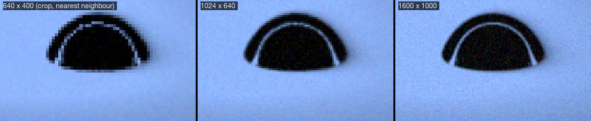

## Scene scale: two modes, never mixed

**Telescope mode** (every presentation preset). The hole has a mass M in solar masses and a distance D in parsecs. The observer is a static observer at

```text
r_g = G M / c²        r₀ = D / r_g        θ_g = r_g / D
shadow radius   sin α_sh = 3√3 √(1 − 2/r₀) / r₀   →   3√3 r_g / D  for r₀ ≫ 1
Einstein radius θ_E = √(4 r_g D_ls / (D_ol D_os))  →  2/√r₀ for a source far behind the hole
```

(*physically derived*; the shadow formula is exact for Schwarzschild, and the validation suite recovers it to 10⁻⁶). The integrator works in units of M; the physical mass enters only the radiometry and the angular scale.

**Local mode** (the Critical Curve Study only). A theoretical camera 30 M from the hole, for geodesic debugging, photon orbits, disk-crossing order and critical-curve maps. Its images are filed as diagnostics, and the page, the FITS header (`SCNMODE`) and every legend say it is not a telescope observation.

| Preset | Mode | Class / size | D | r₀ (M) | Shadow radius | Einstein radius | Field | Pixel |
| --- | --- | --- | ---: | ---: | ---: | ---: | ---: | ---: |
| First Light — Physical Single Exposure | telescope | presentation 1024 × 640 | 850 AU | 2.0 × 10⁴ | 53.6″ | 48.6′ | 48′ × 30′ | 2.8″ |
| First Light — Observatory HDR Composite | telescope | presentation 1024 × 640 | 850 AU | 2.0 × 10⁴ | 53.6″ | 48.6′ | 48′ × 30′ | 2.8″ |
| Lensed H II Region — Offset Source | telescope | presentation 1024 × 640 | 0.024 pc | 1.18 × 10⁵ | 9.1″ | 20.0′ | 100′ × 62′ | 5.9″ |
| Einstein Ring — Structured Alignment | telescope | presentation 1024 × 640 | 0.024 pc | 1.18 × 10⁵ | 9.1″ | 20.0′ | 100′ × 62′ | 5.9″ |
| Narrowband Nebula | telescope | presentation 1024 × 640 | 0.024 pc | 1.18 × 10⁵ | 9.1″ | 20.0′ | 100′ × 62′ | 5.9″ |
| Weak-Lensing Deep Field — Stacked Survey | telescope | presentation 1024 × 640 | 0.21 pc | 10⁶ | 1.1″ | 6.9′ | 16′ × 10′ | 0.94″ |
| Weak-Lensing Deep Field — Physical Frame | telescope | presentation 1024 × 640 | 0.21 pc | 10⁶ | 1.1″ | 6.9′ | 16′ × 10′ | 0.94″ |
| Einstein Ring — Exact Alignment (symmetry test) | telescope | presentation 1024 × 640 | 0.024 pc | 1.18 × 10⁵ | 9.1″ | 20.0′ | 100′ × 62′ | 5.9″ |
| Critical Curve Study | **local** | diagnostic 1280 × 800 | — | 30 | 9.6° | — | 44° × 27.5° | 124″ |

All presets use a 4.3 × 10⁶ M☉ hole. These distances are close by astronomical standards: Sgr A* is 8 kpc away, and its shadow is 26 µas across. The Observatory is a hypothetical telescope parked near the hole, so that the shadow and the lensing are resolvable alongside a star field. Distances to background sources are real: the nebula is 2.5 kpc behind the hole, and the stars and galaxies come from a model of the actual sky. In the Deep Field the shadow is about one pixel. It is a weak-lensing field and is named as one.

## Compared with the real-time renderer

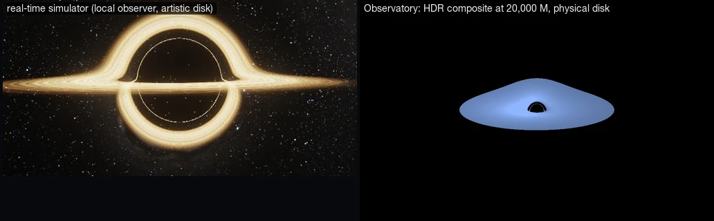

The real-time frame is a strong picture. Its disk brightness, colour, bloom and star field are chosen for effect, and its camera sits 26 M from the hole. The Observatory's First Light differs on each count:

- **Scale.** The telescope is at 20,000 M, so the shadow is 54″ and the disk 20′ across.
- **Disk.** Its radiance comes from the accretion rate, nothing is clipped, and the Doppler side is brighter by the factor the model predicts.
- **Stars.** They appear only because six registered exposures, ten orders of magnitude apart in gain, were merged. The physical single exposure next to it shows what one frame records.

## Relativistic ray integration

*Physically derived.* A photon around a Schwarzschild hole moves in a plane through the hole. With u = 1/r and φ the angle in that plane (G = c = M = 1):

```text
d²u/dφ² = 3 m u² − u,    first integral  (du/dφ)² + u²(1 − 2mu) = 1/b²
```

*Numerically approximated.* The Observatory integrates (u, du/dφ) with an embedded Dormand–Prince 5(4) scheme and adaptive step control (relative tolerance per scene, 1e-7 to 1e-11). Integrating in u makes escape exact: a ray reaches r = ∞ at the finite angle where u = 0, found by Newton iteration, and the radial direction there *is* the ray's direction on the sky. The disk plane is crossed at angles known in advance (φ_c + kπ in the orbital plane), so steps are clipped to land on each crossing exactly. The camera is a static observer: a ray leaving it at angle α has b = r₀ sin α / √(1 − 2m/r₀).

**Validation** (`cargo test`; 22 geodesic and lensing tests):

| Test | Check |
| --- | --- |
| Radial rays | outward rays escape along r̂ (error < 10⁻¹²), inward rays are captured, from r₀ = 2.5 to 10⁶ M |
| Horizon | rays inside the photon sphere that are not outgoing fall through u = 1/(2M) |
| Distant-observer shadow | the bisected capture edge matches sin α_sh = 3√3√(1 − 2/r₀)/r₀ to 10⁻⁶ for r₀ = 50, 10³, 10⁴, 10⁶, and the far-field 3√3 r_g/D to O(1/r₀) |
| Photon orbit | the shadow edge's impact parameter equals 3√3 M to 10⁻⁶ at every distance; a tangential ray at r = 3M stays on the photon sphere |
| First integral | (du/dφ)² + u²(1 − 2mu) − 1/b² stays below 1e-8 for b from 5.3 to 150 |
| Weak field | deflection matches 4m/b + (15π/4)(m/b)²; with m → 10⁻¹², escape directions equal the launch directions to 10⁻⁹ |
| Strong field | deflection near b_c matches Bozza's logarithmic limit for b/b_c − 1 = 1e-4, 1e-6, 1e-8 |
| Tolerance | loosening rtol from 1e-12 to 1e-7 changes fates only for \|b/b_c − 1\| < 10⁻⁴, and escape directions elsewhere by < 10⁻⁵ rad |
| Winding budget | with 1, 2 and 4 allowed turns, the band of failed rays always contains the analytic shadow edge and narrows by > 100× per step; more windings never move the edge |
| Einstein angle | for r₀ = 10⁴ and 10⁶ the ray mapped exactly behind the hole sits at 2/√r₀ within 2% |
| Parity | inside the Einstein ring the escape direction wraps past the axis (mirrored secondary images); outside it does not |
| Disk crossing order | toward the critical curve the photon order of the first disk hit never decreases and reaches ≥ 3 |
| Extended sources | a disc behind a point lens: exact alignment gives a ring at θ_E (5%); at β = 0.5 θ_E the two images sit at (β ± √(β² + 4))/2 (5%) with the point-lens flux ratio 2.69 (10%) |
| Real-time consistency | the real-time shader's Cartesian RK4 and this integrator agree on escape directions to 3e-4 rad |

Near-critical rays amplify integration error by roughly e^φ over their windings, which is why the Critical Curve Study uses rtol 1e-10. Image presets use 1e-8.

## Diagnostics are not pictures

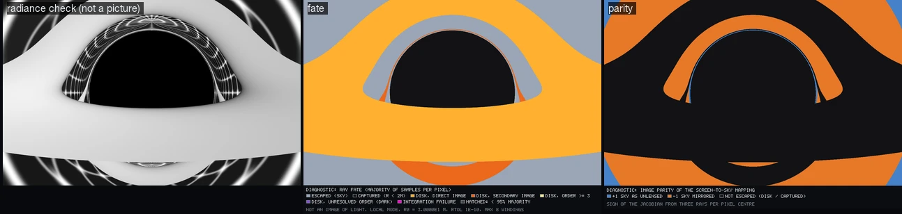
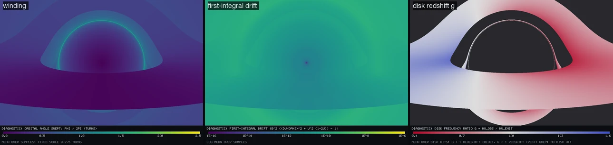

Diagnostics use fixed scales and a legend band baked into the PNG: title, ramp or categories with ticks, units and a note. They use perceptual (viridis) or diverging maps, with no grading. The Critical Curve Study's own image is filed as a *radiance check* among the diagnostics. Its large, warped disk is what a camera 30 M from the hole sees, not a telescope photograph, and it is never used as one.

**Ray fate** uses majority classification, never averaged colours; pixels without a 95% majority are hatched.

| Fate | Colour |
| --- | --- |
| escaped (sky) | desaturated blue-grey |
| captured (r < 2M) | near-black charcoal |
| disk, direct image (order 1) | amber |
| disk, secondary image (order 2) | orange |
| disk, order ≥ 3 | pale yellow |
| disk, unresolved order (traced, left dark) | purple |
| integration failure | magenta |

**Parity** is the sign of the Jacobian of the screen→sky map, from three rays a quarter-pixel apart at each pixel centre. In the critical-curve frame the mirrored region fills the inside of the Einstein ring, and the thin parity-positive band hugging the shadow is the third-order image.

**Source-feature correspondence** (*debug only*). With `landmarks: true` the renderer picks the five brightest Hα knots in the volume, at least 3 pc apart. It records which rays pass within 0.5 pc of each knot and paints those pixels in the knot's colour over a grey image. Rendered with and without lensing, it shows where each knot of the source lands in the arc and in the counter-image. These images live in `out/debug/` and are never exported as presentation.

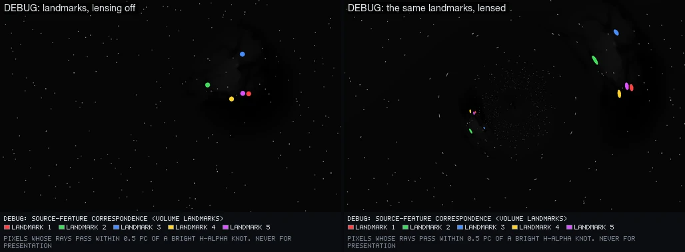

## The disk and First Light

*Physically derived.* The radial flux is the Page–Thorne (1974) zero-torque solution for a thin disk around a Schwarzschild hole, tabulated numerically. It peaks at r = 9.55 M (tested), and its absolute scale comes from the scene:

```text
Ṁ = λ_Edd L_Edd / (η c²),   L_Edd = 1.257 × 10³¹ W (M/M☉),   η = 1 − E(r_in) = 0.0572
F(r) = (Ṁ c² / r_g²) · F̃(r/M),   T_eff = (F/σ)^¼
```

In the Newtonian limit this reduces to 3GMṀ/(8πR³)(1 − C/√R) (tested). For First Light (λ_Edd = 0.01) the code reports Ṁ = 1.7 × 10⁻³ M☉/yr, T_eff,max = 86,700 K at 9.55 M and H/r ≤ 0.0065, so the thin geometry is consistent. *Numerically approximated:* each element emits a colour-corrected blackbody, I_ν = f_col⁻⁴ B_ν(f_col T_eff) with f_col = 1.7, seen with g = [1/√(1 − 2/r₀)] / [uᵗ(1 − Ωλ)]. In visible light the disk is in its Rayleigh–Jeans tail: blue-white, slowly varying with radius, with a Doppler asymmetry roughly proportional to g. The disk is optically thick by default. A finite vertical optical depth is *experimental*, and the artistic multiplier stays at 1.

At 550 nm its radiance is about 5 × 10²⁴ photons s⁻¹ m⁻² sr⁻¹ nm⁻¹, some 70 times the Sun's surface. That makes First Light two products:

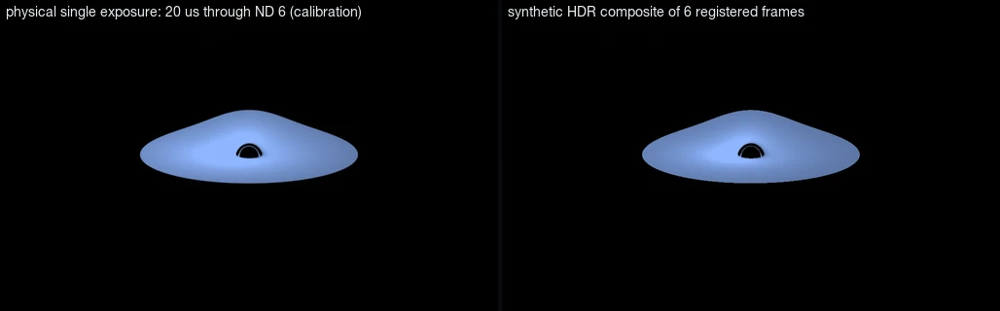

**First Light — Physical Single Exposure** is the calibration frame. A real camera needs a solar-grade ND 6 filter and a 20 µs exposure to keep this disk below full well. At that exposure the background stars are about 10¹² times too faint to register, so the sky is black. This is the honest single detector frame.

**First Light — Observatory HDR Composite** is *a synthetic HDR composite of registered virtual exposures, not a single detector frame*, and every export says so. The same scene and telescope are recorded as a ladder of six frames, each a physical frame in its own right (saved under `out/presentation/frames/`):

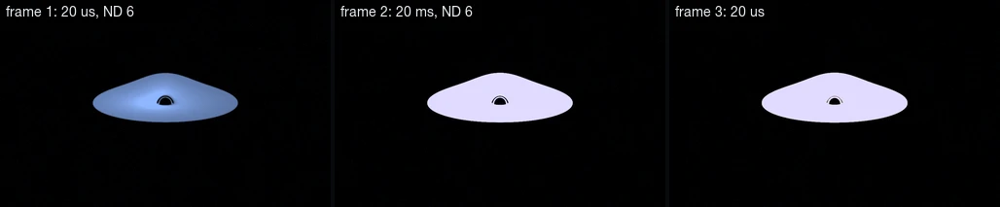
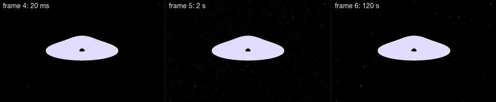

The effective exposure t × 10^−ND steps by about 10³ between frames, the sensor's own dynamic range (full well / read noise ≈ 1.7 × 10⁴). Merging happens in linear units, per pixel and per filter:

```text
R = Σ_k (S_k − n_k · dark · t_k) / Σ_k n_k g_k,   g_k = t_k 10^−ND_k,   over frames with μ_k < 0.95 full well
```

Saturated frames are dropped and dark current subtracted, which gives the maximum-likelihood rate (a group of n identical frames is drawn exactly as one Poisson(n μ) plus √n read noise). A test checks that rates across ten decades are recovered within their noise. The composite is then shown with **one global, monotone display curve** (`hdr_log`):

1. A logarithmic segment from the sky floor to the brightest star, lifted at its faint end.
2. The empty range of intensities between the brightest star and the faintest disk pixel, squeezed to a sliver. It is found automatically from the histogram.
3. A segment linear in displayed brightness from the faintest disk pixel to white, so the disk keeps its radial and Doppler gradients.

There is no local tone mapping, no bloom and no unsharp mask.

First Light uses ideal optics: an Airy core plus 2″ blur, with no scattered-light halo. With a 1% Moffat halo, the glare of a source of 10¹⁵ e⁻/s outshines every star within two arcminutes. A real telescope would show that glare, so treat the halo-free optics as a stated idealisation.

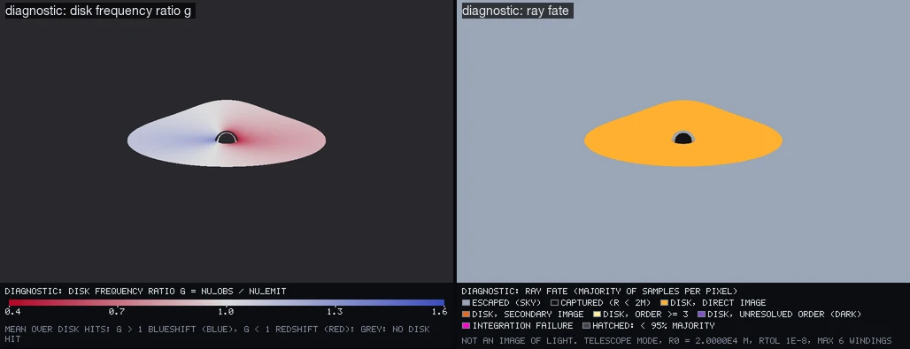

## Lensing a nebula at a finite distance

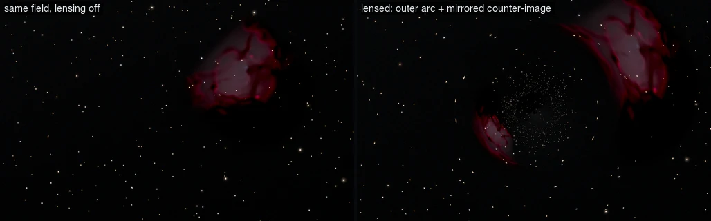

The nebula's centre is placed where the observer sees it: at angular offset β from the observer–hole axis, a distance D_ol + D_ls from the observer. Escaped rays continue as straight lines from the hole along their asymptotic direction. That is the asymptotic-sky (thin-lens) approximation, good to b/voxel ~ 10⁻⁵ (*numerically approximated*).

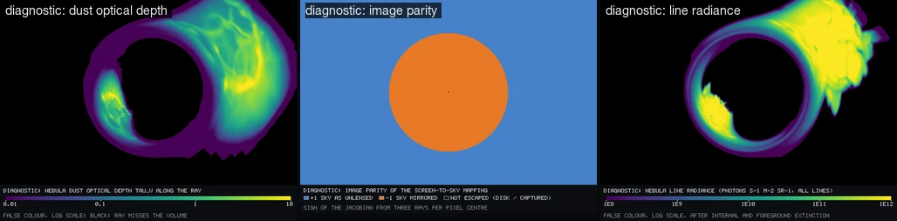

**Foreground and background stars.** Each catalogue star keeps the distance of the line-of-sight shell it was drawn from. Stars nearer than the nebula's front face (2.49 kpc) are drawn unattenuated on top of it. Stars behind it are dimmed and reddened by its dust along their own ray. Stretched stars appear only where the geodesics stretch the sky, near the Einstein ring.

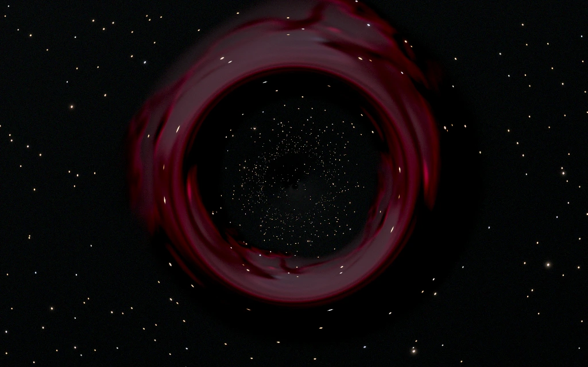

**Einstein Ring — Structured Alignment** is the ring showcase. The source sits 4.7′ off axis, about a quarter of θ_E. The ring is mostly complete but uneven, brighter and wider on the source's side, and the nebula's knots and dust lanes repeat around it.

**Einstein Ring — Exact Alignment** is a *symmetry test* and is labelled as one. Only exact alignment closes a symmetric ring.

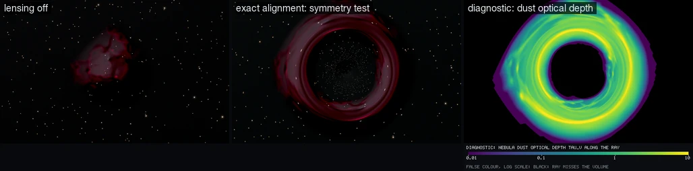

## The nebula volume

![Orthographic previews of the generated 96³ volume before lensing: column density, ionized fraction, two-phase temperature, dust optical depth, H α, [O III], [S II] and scattered starlight.](docs/volume-inspect.webp)

*Numerically approximated: a procedurally seeded, physically motivated H II region generator, not radiation-hydrodynamics or MHD.* `observatory volume` evolves a 24 pc box:

- **Gas** starts as a turbulent molecular cloud: a lognormal density field, which is the only place noise is used.
- **Ionization** from three massive stars (Q = 5 × 10⁴⁷ to 1.2 × 10⁴⁹ s⁻¹) is cast along rays against case-B recombinations. This is the Strömgren balance (*physically derived*; a uniform-gas test recovers the analytic radius within 8%), so dense clumps cast neutral shadows.
- **Flow** obeys the Euler equations in conservative form, with pressure P = n(1 + x)kT set by the ionization state, using a first-order donor-cell scheme with open boundaries. There is no energy equation, self-gravity or magnetic field.
- **Emission:** Hα and Hβ come from case-B recombination (*physically derived*). [O III], [N II] and [S II] use line ratios tied to the local ionization parameter (*statistically chosen* within observed H II-region ranges). Dust absorbs, and scatters starlight once.

`observatory inspect` renders these previews and measures a **grid-scale noise index**, the mean |f − mean of 6 neighbours| / f inside the ionized gas. It showed that the first-order collocated scheme leaves an odd–even (checkerboard) density mode at the grid's Nyquist scale, which n² line emission amplifies: the Hα index was 0.42 and [S II] 0.97. Two solver-level fixes were tried. Rusanov fluxes diffused the neutral shell into the H II region until it recombined. Fourth-order hyperdiffusion erased the turbulent structure. Neither was kept.

The cached fields now carry a documented **reconstruction filter**: one separable [1, 2, 1]/4 binomial pass. It removes the Nyquist mode exactly, halves a 4-voxel wave and leaves 16-voxel structure within 4% per axis. Afterwards the indices are Hα 0.078, [O III] 0.014 and [S II] 0.19, with [S II] limited by its sharp ionization fronts. The previews show coherent shells, cavities, pillars and dust lanes.

**Radiative transfer.** Front to back, per spectral channel, with jittered steps:

```text
L ← L + T · j · (1 − e^{−Δτ}) / Δτ · Δs,     T ← T · e^{−Δτ}
```

(exact for piecewise-constant j and α; the weight uses its series below Δτ = 10⁻², where single precision would lose 1 − e^{−Δτ}). Fields are interpolated trilinearly. They fade to zero over the outer 3 voxels, so the box never shows as an edge. Empty 8³ bricks are skipped (empty means below 10⁻⁵ of peak emission and τ < 3 × 10⁻³ per brick; the τ diagnostic shows those brick boundaries at the 1% level, the image does not). Order of attenuation: internal dust in the march, then foreground Galactic extinction toward the nebula from the sky model (A_V ≈ 0.96 at 2.5 kpc, b = −4.4°).

Tests cover the following:

| Test | What it checks |
| --- | --- |
| Empty volume | leaves the background untouched |
| Uniform absorber | matches Beer–Lambert, including the wavelength dependence |
| Uniform emitter–absorber slab | matches (j/α)(1 − e^{−τ}) to 10⁻³ |
| Step convergence | on a smoothly varying volume, the march converges with step size: 1% at half a voxel, 0.3% at a quarter |
| Surface brightness | an extended source keeps its surface brightness at 1 and 4 kpc while its angular size scales as 1/D |

## The deep sky and the Weak-Lensing Deep Field

*Statistically synthesized.* The background is the population model from the real-time simulator's calibrated synthetic sky: thin and thick disc, bar, halo, Kroupa mass function, and a dust disc with lognormal clouds. Its all-sky counts match the real sky's N(<V) within 30% at V = 6 and 12 (tested). Telescope fields need two depths at once:

- **All-sky layer:** stars to V ≈ 9, because rays near the hole can map to any direction.
- **In-field layer:** inside a cone around the field centre, a deep catalogue on a tangent-plane index. In the Deep Field this is 17,800 stars to V = 22 and 6,900 galaxies to m = 23.5 within 1°, wide enough that demagnified images within θ_E²/R ≈ 0.8′ of the hole are the only place it ends. The all-sky layer is suppressed inside the cone.
- **Unresolved light** fainter than the deep limit forms one all-sky map, blended to a single value at each galactic pole. The first Deep Field sat exactly on the pole and showed a fan-shaped artefact of the old equirectangular lookup.

Galaxy counts are Euclidean to m = 20 and then flatten to slope 0.45; sizes use D_A = D_L/(1 + z)². Stars are Gaussian spots of σ = 0.35 pixel on the sky *before* lensing, so lensing stretches them only through the geodesics.

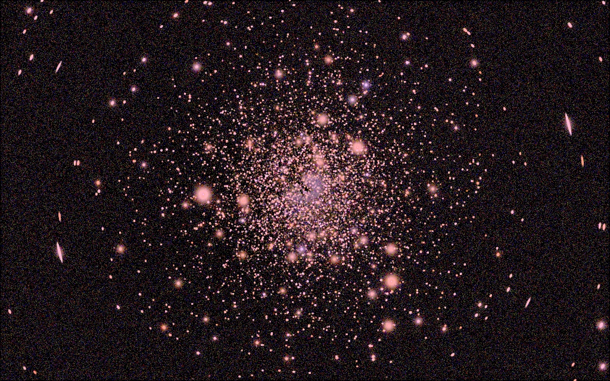

**Why the first Deep Field was dark and noisy: an audit.** `observatory photometry <scene>` traces every term from magnitude to electrons:

- **Zero point.** V = 0 ↔ 1.0 × 10⁸ photons s⁻¹ m⁻² nm⁻¹ at 550 nm, the AB value of 3631 Jy within 5% (tested).
- **Rates.** Filter × QE × bin width, then collecting area and pixel solid angle.
- **Backgrounds.** The sky background per pixel is taken from the model at the field centre. Dark current and read noise follow, and there is no zodiacal light or airglow, because the observer is far from the Sun and in space.
- **Point sources.** The peak-pixel fraction of a point source comes from the PSF at the render's plate scale.

For the stacked field:

| Filter | Sky (e⁻/s/px) | m = 20 peak S/N, 1 × 3600 s | m = 22 peak S/N, 1 × 3600 s | m = 22 peak S/N, 36 × 300 s |
| --- | ---: | ---: | ---: | ---: |
| L | 0.117 | 158 | 60 | 103 (L is 3 h) |
| R | 0.035 | 92 | 35 | 59 |
| G | 0.043 | 96 | 36 | 61 |
| B | 0.036 | 82 | 31 | 51 |

The old 10 cm field gave m = 22 a peak S/N of 18 in an hour, so the counts were never the problem. The **display** was. Its white point sat on stars that saturate in an hour (V < 17), which put faint galaxies at about 3% grey. Its black point sat far below the sky, so the sky's own shot noise (σ ≈ 15 e⁻ on 240 e⁻) filled the frame as grain.

The repair has two parts:

- **Optics.** A 30 cm f/2.75 telescope with 0.94″ pixels, so galaxies of m ≈ 17–20 (r_e ≈ 1–3″) are resolved instead of single-pixel dots.
- **Display.** The black point sits at the sky level per channel (background neutralization), and a highlight shoulder replaces hard clipping.

The **Physical Detector Frame** is one honest hour. The **Stacked Survey Composite** is 36 registered 300 s frames, 3 h in total, merged in linear units. Its 300 s frames keep stars down to V ≈ 17 below full well, where the hour-long frame saturates everything brighter than V ≈ 19.5. The read noise is paid 36 times. Both are recorded in the metadata.

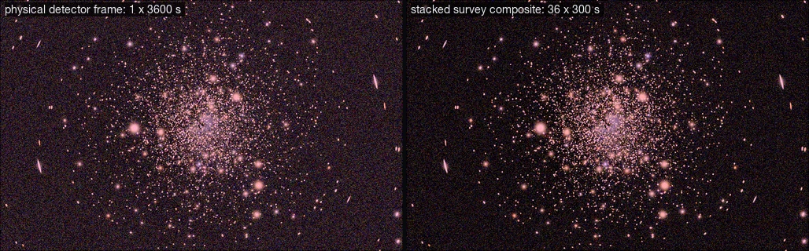

## The synthetic sensor and the display

Per filter (*physically derived* unless marked):

1. **Rate:** e⁻ s⁻¹ = Σ channels N̄ × (filter × QE × bin width) × collecting area × pixel solid angle.
2. **PSF** (*numerically approximated*): a Gaussian core with FWHM² = FWHM_optics² + (1.03 λ_eff/D)². The optics/seeing FWHM is given in arcseconds and converted at the render's own plate scale. A Moffat halo (1%, 0 in First Light) and optional spikes sit on a circular, tapered support. The wide part is FFT-convolved, and flux is conserved to 0.2% (tested).
3. **Exposures:** a single frame (t, ND), or a list of registered frames with counts, merged as above. t scales with min(1, spp/target).
4. **Noise:** Poisson by CDF inversion at a per-pixel frozen uniform, Gaussian read noise, dark current and full-well saturation. Cosmic rays are off by default. Stacking reduces noise as 1/√N (tested).

**Display transforms** are part of the scene and recorded in every export:

| Parameter | Meaning |
| --- | --- |
| `display_transform` | `linear`, `asinh`, `filmic` (ACES-style), `narrowband_sho`, `hdr_log` |
| `black_point_percentile`, `white_point_percentile` | quantiles of the image intensity |
| `display_softness` | asinh softness |
| `highlight_rolloff` | a tanh shoulder above this fraction of white instead of clipping |
| `background_neutralization` | per-channel black points at the sky level (neutral dark sky) |
| `hdr_decades` | the log range of `hdr_log` |
| `star_density_scale`, `galaxy_density_scale` | catalogue density multipliers, *artistic* when ≠ 1; every preset uses 1 |

Broadband RGB and LRGB use the colour-preserving asinh stretch of Lupton et al. (2004), on channels white-balanced to a G2V (5800 K) star.

**`narrowband_sho`** normalises each line to its own white point, as the SHO convention requires. It then gives the three a *shared* colour-preserving stretch, slightly desaturated, so hue follows the line ratios. Independent per-channel stretches would saturate into cyan and acid green and hide density structure.

![Narrowband Nebula: the raw [S II], Hα and [O III] planes (noise-free expected electrons).](docs/narrowband-planes.webp)
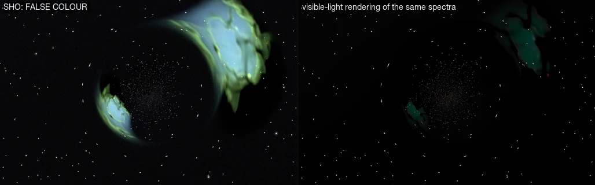
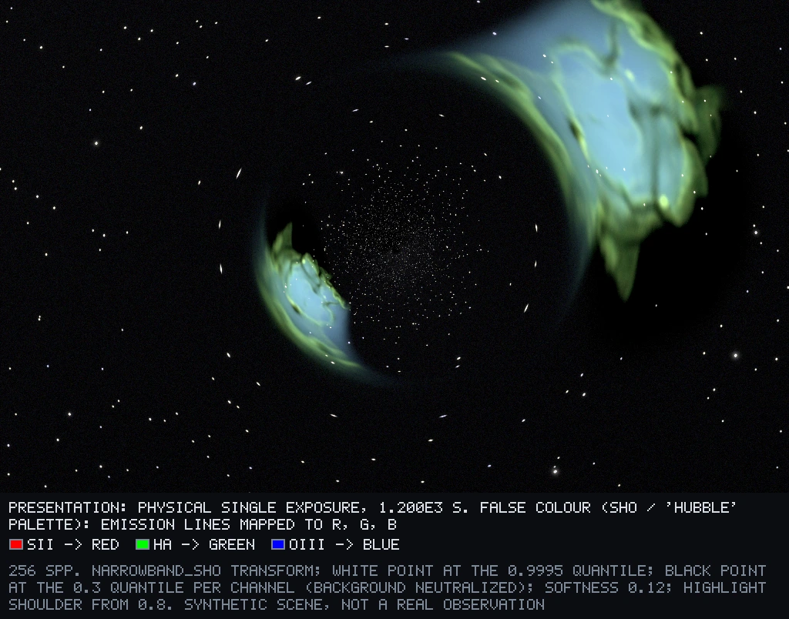

The visible-light rendering looks teal because the eye's sensitivity at 501 nm ([O III]) is about four times its sensitivity at 656 nm (Hα). An RGB sensor sees the same nebula red. Both are correct for their detectors.

## Exports

| Format | Contents |
| --- | --- |
| **PNG** | one named transform per file; text chunks `Class`, `PresentationMode`, `View`, `Palette`, `Display`, `Exposures`, `Comment`; diagnostics include their legend |
| **OpenEXR** | linear float channels: per-filter realised electrons, expected electrons and calibrated rate, plus all 26 spectral radiance channels |
| **FITS** | standards-conforming primary HDU, one plane per filter. Single exposures are in electrons; composites are calibrated rates (`BUNIT = 'electron/s'`, `COMPOSIT = T`, `NFRAMES`). Headers also record `OUTCLASS` and `PRESMODE`, with mode, mass, distance, shadow radius, disk accretion rate, ND filter and instrument |
| **JSON** | the scene, convergence timeline, timings, display description, frames taken, and an `outputs` map from file to class |

## Presets, validation and fixtures

| Preset | Purpose |
| --- | --- |
| **First Light — Observatory HDR Composite** | the introductory black-hole image: a registered HDR composite, labelled as such |
| **First Light — Physical Single Exposure** | the calibration frame: 20 µs through ND 6 |
| **Lensed H II Region — Offset Source** | the nebula showcase: arc and counter-image with corresponding structure; unlensed comparison, τ, parity |
| **Einstein Ring — Structured Alignment** | the ring showcase: nearly aligned, uneven, structured |
| **Narrowband Nebula** | raw [S II], Hα, [O III] planes; labelled SHO composite; visible-light rendering; EXR and FITS cube |
| **Weak-Lensing Deep Field — Stacked Survey** / **Physical Frame** | faint galaxies, weak lensing at 6.9′, with an audited photometric budget |
| **Einstein Ring — Exact Alignment** | symmetry test |
| **Critical Curve Study** *(local observer)* | geodesic validation at 1280 × 800: fate, parity, winding, invariant, steps, redshift |

**Validation renders** (512 px, `out/validation/`) are geometry checks, not pictures.

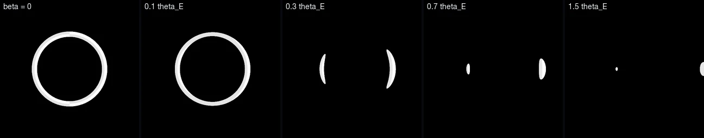
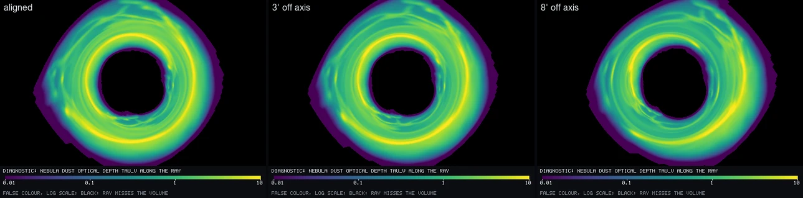
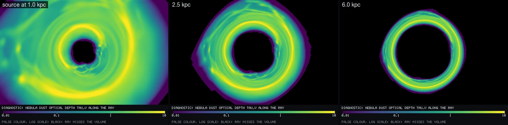
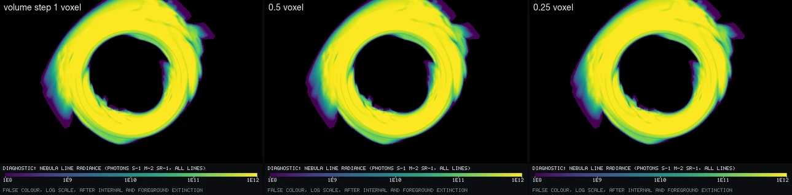

`observatory fixtures` renders each preset at 128 px (scaling every exposure with the pixel solid angle). It checks each render against the preset's `checks` block:

- no NaN or negative radiance;
- clipping, saturation and failed rays within limits;
- disk occupancy and shadow fraction within the preset's ranges;
- resolved-star density within its limit;
- the volume reached by a minimum fraction of pixels.

It then compares each render with the stored fixture in `fixtures/` (2% L1 per plane, plus a shadow-size check). `cargo test` runs it.

## Spectral transport and redshift

The transported quantity is **photon spectral radiance per unit wavelength**, N_λ (photons s⁻¹ m⁻² sr⁻¹ nm⁻¹), in 20 continuum bins of 30 nm from 360 to 960 nm. Six emission lines ride alongside as integrated radiance at their exact wavelengths: Hβ, [O III] 5007, Hα, [N II] 6583 and [S II] 6716/6731. *Physically derived:* N_λ,obs(λ) = g⁴ N_λ,emit(gλ); lines transform as g³ and move to λ_rest/g. Sky light reaching a static observer is blueshifted by 1/√(1 − 2/r₀), which is negligible in telescope mode. Filters (U, B, V, R, I; L, R, G, B; 5 nm Hα, [O III], [S II]) and a CMOS quantum-efficiency curve act on the spectrum before any colour conversion.

## Measurements

All numbers come from `scripts/captures.sh` (native CLI, 10 threads) on a **MacBook Air M4** (4 performance + 6 efficiency cores, 16 GB, fanless). The machine throttles under sustained load, so throughput varies by up to 2× between runs of the same scene. The image data are deterministic.

**Presentation renders** (1024 × 640 unless noted):

| Render | spp | Samples/s | Geodesic steps / sample | Volume steps / ray in volume | Sampling time | Export (all files) | Saturated |
| --- | ---: | ---: | ---: | ---: | ---: | ---: | ---: |
| First Light — single exposure | 256 | 2.94 M | 36.4 | – | 57 s | 0.43 s | 0 |
| First Light — HDR composite (6 frames) | 256 | 2.60 M | 36.4 | – | 65 s | 1.5 s (+ 6 frame PNGs) | 0 unrecoverable |
| Lensed H II Region — Offset | 256 | 0.44 M | 30.3 | 113 | 380 s | 4.0 s (incl. parity) | 0.03% |
| … same field, lensing off | 256 | 0.80 M | – | 131 | 210 s | 0.9 s | 0.04% |
| Einstein Ring — Structured | 256 | 0.29 M | 30.3 | 156 | 582 s | 1.7 s | 0.03% |
| Einstein Ring — Exact | 256 | 0.26 M | 30.3 | 160 | 651 s | 1.0 s | 0.03% |
| Narrowband Nebula | 256 | 0.42 M | 30.3 | 113 | 396 s | 1.0 s | 0.01% |
| Deep Field — physical frame | 512 | 3.98 M | 29.2 | – | 84 s | 1.2 s | 0.05% |
| Deep Field — stacked (36 frames) | 512 | 3.92 M | 29.2 | – | 86 s | 2.1 s | 0 |
| Critical Curve Study (1280 × 800, rtol 1e-10) | 64 | 1.70 M | 49.1 | – | 39 s | 6.6 s (incl. 1280 × 800 parity map) | 0 (ideal detector) |

Saturation means pixels saturated in *every* frame. They are isolated stellar cores.

**Time to 256, 1,024 and 4,096 samples per pixel** (First Light single exposure at 320 × 200, a benchmark, not a presentation):

| spp | Wall time | Renderer noise (median relative error, brightest tenth) | Sensor noise |
| ---: | ---: | ---: | ---: |
| 256 | 8.0 s | 0.110% | 0.66% |
| 1,024 | 31.5 s | 0.055% | 0.66% |
| 4,096 | 143.2 s | 0.028% | 0.66% |

The renderer noise halves for every 4× samples (1/√N). The sensor noise stops at 256 spp, where the exposure is complete.

**Resolution scaling** (First Light, 16 spp): 640 × 400 in 1.9 s, 1024 × 640 in 5.9 s, 1600 × 1000 in 13.4 s. Sampling time scales with the pixel count, while angles, flux and the PSF in arcseconds stay fixed (tested).

**Memory** (native peak resident, 1024 × 640): First Light HDR 590 MiB, offset nebula 671 MiB (including the decoded volume), Deep Field stack 684 MiB (5,600 stars and 2,000 galaxies in the in-field layer), Critical Curve Study at 1280 × 800 763 MiB. Most of it is the per-pixel accumulators: 26 spectral channels and 18 diagnostics. There is no GPU work.

**Reproducibility.** A 160 × 100 render to 64 spp in one go, and to 32 spp followed by a checkpoint resume to 64, give **bit-identical EXR files** (all radiance channels and sensor planes). `observatory fixtures` re-renders every preset at 128 px and compares it with the stored fixtures; all nine pass.

**Tests.** `cargo test --release` runs 60 unit tests plus the preset fixture test, all passing. The unit tests cover:

- geodesics and observer geometry;
- point-lens checks of finite sources;
- the disk's absolute flux;
- volume transfer and its step convergence;
- the sky model and the photometric zero point;
- resolution invariance;
- HDR merging over ten decades and stack noise ∝ 1/√N;
- the sensor (Poisson statistics, linearity, PSF flux, dark frames, filters);
- exporters, determinism and checkpoints.

## What it gets right

- Every scene declares its scale: telescope images have physical angular sizes, and the one local-observer scene is a labelled diagnostic.
- Every image declares its class. Presentation images are native 1024 × 640 renders. Composites and stacks are labelled as such, with their frames saved, and false colour is named.
- Lensing, multiple images, parity and photon orders come from integrating every ray to a tolerance, checked against analytic limits and point-lens theory. Source features correspond between arc and counter-image (debug overlay).
- The disk's brightness follows from its accretion rate. The exposure follows from the brightness, and so does the need for an HDR composite.
- Photometry is auditable from magnitude to electrons, and the display is never asked to rescue a calibration error.
- Renderer noise and sensor noise are separate. Renders are bit-reproducible across threads and checkpoints.

## What remains approximate or artistic

- **Hypothetical vantage point.** The telescopes are hundreds of AU to 0.2 pc from a Sgr A*-like hole.
- **Static observer**, stationary scene.
- **Thin disk:** blackbody with a colour correction, no atmosphere, corona or jet. First Light assumes ideal optics with no scattered-light halo.
- **Display curves** are presentation choices, recorded in every file. The HDR curve removes empty dynamic range, and the SHO palette is false colour.
- **Asymptotic-sky lensing** of the nebula (error ~10⁻⁵ of a voxel).
- **Nebula physics:** two-phase temperature, first-order advection, empirical line ratios, single scattering, 96³ voxels with a Nyquist reconstruction filter.
- **The sky is a model:** one realisation. Beyond the in-field square its faint sources are tiled statistically, and star distances come from 12 line-of-sight shells.
- **Sensor:** the normal approximation above N = 30; no flat field, bias structure or dithering.
- **No Kerr.** A spinning hole needs its own validated integrator. Until then nothing here is called Kerr.

## Running it

```sh
# browser (output class menu: fixture 128 / validation 512 / presentation 1024 / high quality 1600)
./build_web.sh

# native
cargo build --release -p observatory-cli
./target/release/observatory render presets/first-light-hdr.json --tree out --name first-light-hdr
./target/release/observatory render presets/lensed-hii-offset.json --tree out --name offset --views radiance,tau,parity
./target/release/observatory render presets/lensed-hii-offset.json --tree out --name offset-flat --unlensed
./target/release/observatory render presets/lensed-hii-offset.json --tree out/debug --name landmarks --set landmarks=true --set output_class=validation --views correspondence
./target/release/observatory render presets/narrowband-nebula.json --tree out --w 1600 --h 1000 --set output_class=high_quality
./target/release/observatory photometry presets/deep-field-stack.json
./target/release/observatory inspect volumes/lensed-nebula-96.obsvol
./target/release/observatory fixtures

# everything in this document
./scripts/captures.sh && ./scripts/docs_images.sh
cargo test --release
```
